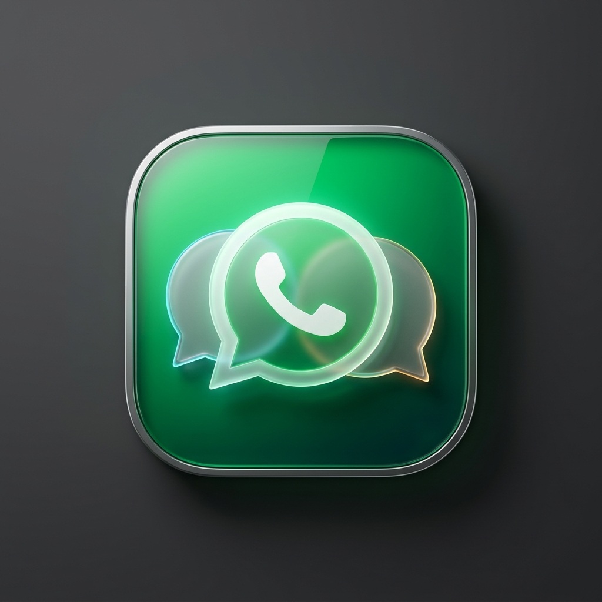

# MultiWhats — Professional Multi-Account WhatsApp Desktop App for macOS

<p align="center">
  
</p>

<p align="center">
  <strong>MultiWhats</strong> is an open-source, production-grade macOS desktop client built with <strong>Rust</strong>, <strong>Tauri 2.x</strong>, <strong>React 19</strong>, and <strong>Tailwind CSS</strong> that allows users to manage multiple independent WhatsApp accounts simultaneously with <strong>true hardware-level session isolation</strong>.
</p>

<p align="center">
  <a href="https://github.com/rsmmonaem/MultiWhats/releases"></a>
  <a href="https://github.com/rsmmonaem/MultiWhats/blob/main/LICENSE"></a>
  <a href="https://github.com/rsmmonaem"></a>
  
  <a href="https://wa.me/?text=Hi%20Monaem,%20reaching%20out%20about%20MultiWhats"></a>
</p>

---

## 🌟 Key Highlights

- **Multi-Account Management**: Run Personal, Business, Support, and VIP accounts in one unified window.
- **Genuine Session Isolation**:
  - **macOS**: Apple WebKit hardware-isolated `WKWebsiteDataStore` profile (`data_store_identifier`).
  - **Windows**: Microsoft Edge WebView2 dedicated User Data Directory (`profiles/<account_id>`).
  Cookies, IndexedDB, and localStorage are 100% segregated.
- **Cross-Platform Compatibility**: Full native builds and installer packaging for both **macOS (Apple Silicon & Intel)** and **Windows (x64)**.
- **Automatic In-App Updates**: Seamlessly receives and installs new releases directly from GitHub Releases (`@tauri-apps/plugin-updater`).
- **Official WhatsApp Web**: Directly loads official `web.whatsapp.com` over HTTPS with desktop user-agent spoofing for instant QR rendering.
- **Persistent Sessions**: Logged-in accounts survive application restarts—no repetitive QR scans.
- **Native OS Experience**: Translucent sidebar, overlay titlebar controls, responsive layout, dark/light themes, and quick keyboard shortcuts (`⌘1`–`⌘9`, `⌘N`, `⌘R`, `⌘,` on Mac / `Ctrl+1`–`Ctrl+9`, `Ctrl+N` on Windows).
- **Embedded Local SQLite Database**: Local fast metadata storage with zero cloud dependence.
- **Zero-Interference Privacy**: Never reverse-engineers the WhatsApp protocol, never collects chat contents, contacts, OTPs, or credentials.

---

## 👤 Author & Open Source Maintainer

- **Creator & Lead Desktop Architect**: **MOHAMMAD MUNAYAM SOWDAGOR (RSM Monaem)**
- **GitHub**: [@Rsmmonaem](https://github.com/Rsmmonaem/)
- **LinkedIn**: [MOHAMMAD MUNAYAM SOWDAGOR](https://www.linkedin.com/in/rsm-monaem/)
- **WhatsApp Developer Contact**: `@rsmmonaemwp` ([Direct WhatsApp Chat](https://wa.me/?text=Hi%20Monaem,%20reaching%20out%20about%20MultiWhats))
- **Repository**: [https://github.com/rsmmonaem/MultiWhats](https://github.com/rsmmonaem/MultiWhats)
- **License**: [MIT Open Source](LICENSE)

Contributions, feature requests, and issue reports from the open-source community are warmly welcomed!

---

## 🏗️ Architecture & Session Isolation

```
┌─────────────────────────────────────────────────────────────┐
│ MultiWhats Desktop Window (macOS WKWebView Host)            │
├──────────────────┬──────────────────────────────────────────┤
│ Native Sidebar   │ Active Account Header (⌘R, Logout)       │
│                  ├──────────────────────────────────────────┤
│ • Personal  (⌘1) │                                          │
│ • Business  (⌘2) │ Native Isolated Child Webview            │
│ • Sales     (⌘3) │ [WKWebsiteDataStore for UUID-A]          │
│                  │ web.whatsapp.com                         │
│ + Add Account    │                                          │
│ ☼ Theme / Info   │                                          │
└──────────────────┴──────────────────────────────────────────┘
```

### Why Standard Multi-Window Approaches Fail on macOS
In vanilla Tauri/WebKit configurations, all webview windows bind to `WKWebsiteDataStore.default()`. Opening multiple windows causes accounts to cross-contaminate and overwrite session cookies.

### The MultiWhats Isolation Engine
MultiWhats implements Apple's WebKit Sonoma/Sequoia native data store identifier API:

```rust
// src-tauri/src/manager.rs
let builder = WebviewBuilder::new(&target_label, url)
    .data_store_identifier(account.data_store_bytes) // Maps to [WKWebsiteDataStore dataStoreForIdentifier:uuid]
    .user_agent(SAFARI_USER_AGENT)
    .auto_resize();
```

Each account receives a unique UUID v4. WebKit creates a segregated physical directory in:
`~/Library/WebKit/WebsiteDataStore/<UUID>/`
When switching accounts, MultiWhats simply toggles webview visibility (`show`/`hide`), preserving active WebSocket connections, chat states, and drafts with zero reload lag.

---

## 🚀 Getting Started

### Prerequisites
- macOS 14.0 (Sonoma) or newer (Apple Silicon M1/M2/M3/M4 or Intel)
- [Rust](https://rustup.rs/) (1.88+)
- [Node.js](https://nodejs.org/) (20+) and npm
- Xcode Command Line Tools (`xcode-select --install`)

### Installation & Run

1. **Clone the repository**:
   ```bash
   git clone https://github.com/rsmmonaem/MultiWhats.git
   cd MultiWhats
   ```

2. **Install frontend dependencies**:
   ```bash
   npm install
   ```

3. **Launch in development mode**:
   ```bash
   npm run tauri dev
   ```

---

## 📦 Building for Production

### Build the macOS `.app` and `.dmg`
To compile optimized binaries and create the disk image installer:
```bash
npm run tauri build
```

Generated deliverables:
- **macOS Application**: `src-tauri/target/release/bundle/macos/MultiWhats.app`
- **DMG Installer**: `src-tauri/target/release/bundle/dmg/MultiWhats_1.0.0_aarch64.dmg`

---

## 🔄 Automatic Updates System

MultiWhats includes a fully integrated, cryptographically verified auto-updater powered by `@tauri-apps/plugin-updater`.

### How It Works
1. Every new release is built and signed using an Ed25519 keypair.
2. The public key is embedded in `tauri.conf.json`:
   ```json
   "plugins": {
     "updater": {
       "pubkey": "dW50cnVzdGVkIGNvbW1lbnQ6IG1pbmlzaWduIHB1YmxpYyBrZXk6IEJEMjUzNTVGNjUzOUEyNEIKUldSTG9qbGxYelVsdmNhZENodTdsZUsrK01LbWgrczNpQW1DWERrai9rZmlpZ0RDSVZOeCs0NE8K",
       "endpoints": [
         "https://github.com/rsmmonaem/MultiWhats/releases/latest/download/latest.json"
       ]
     }
   }
   ```
3. When MultiWhats starts, it queries the GitHub Release endpoint.
4. If a newer version is found, an update banner appears with one-click **"Update Now"**, which downloads the release, verifies its signature, installs the binary, and relaunches the app.

---

## ⌨️ Keyboard Shortcuts

| Shortcut | Description |
|---|---|
| `⌘1` – `⌘9` | Instantly switch to Account 1 through 9 |
| `⌘N` | Open **Add Account** dialog |
| `⌘R` | Reload the active WhatsApp Web session |
| `⌘,` | Open **System Information & Auto-Update** dialog |
| `Esc` | Close any active modal dialog |

---

## 🔒 Security & Privacy Guarantees

- **No Credential Access**: MultiWhats never reads or intercepts passwords, OTPs, or QR codes. All authentication takes place directly on official WhatsApp Web servers.
- **Hardware Isolation**: Each session's WebCrypto and storage are isolated via Apple WebKit `WKWebsiteDataStore`.
- **Zero Script Scraping**: No DOM scripts are injected into chats or contact lists.
- **Keychain Security**: Account notes are stored in the user's macOS Keychain (`com.multiwhats.desktop`).

---

## 🤝 Contributing

We welcome contributions! Please read our [CONTRIBUTING.md](CONTRIBUTING.md) guide for details on our code of conduct and development setup.

---

## 📄 License

Distributed under the **MIT License**. See [`LICENSE`](LICENSE) for more information.

*Disclaimer: MultiWhats is an independent project developed by MOHAMMAD MUNAYAM SOWDAGOR (RSM Monaem). WhatsApp is a registered trademark of Meta Platforms, Inc. This application is not affiliated with or endorsed by Meta Platforms, Inc.*
